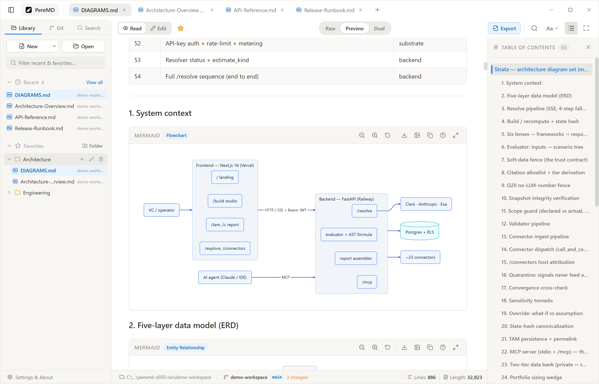
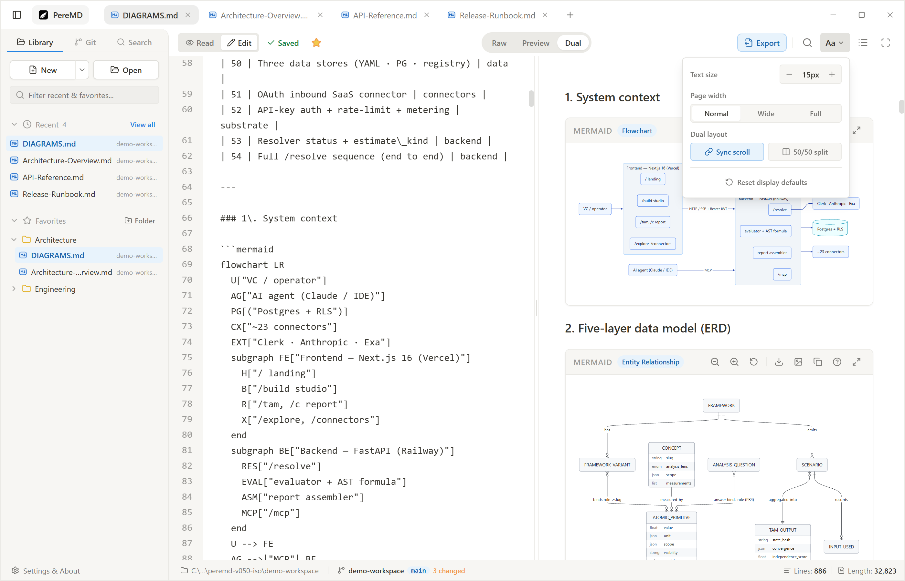
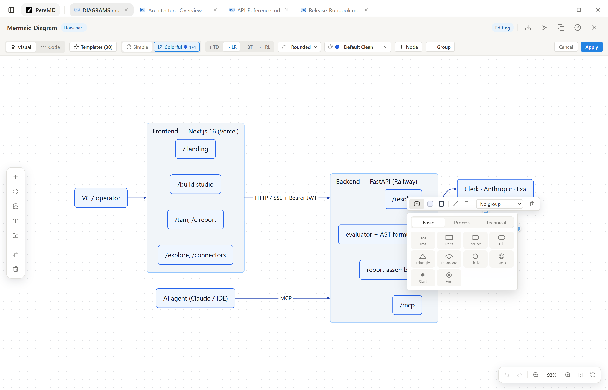
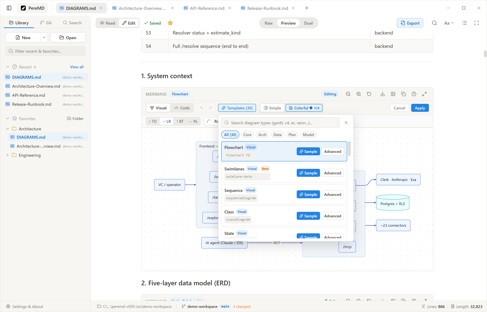
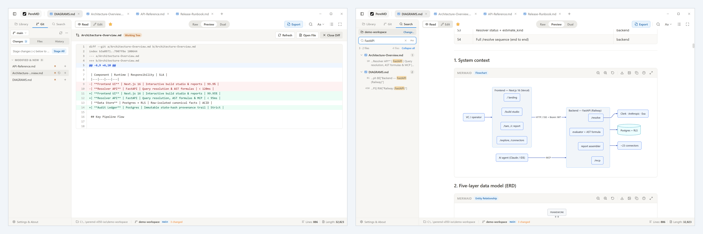
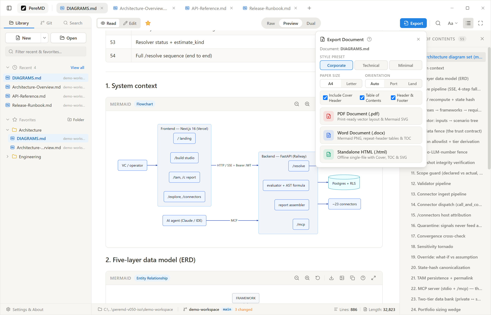
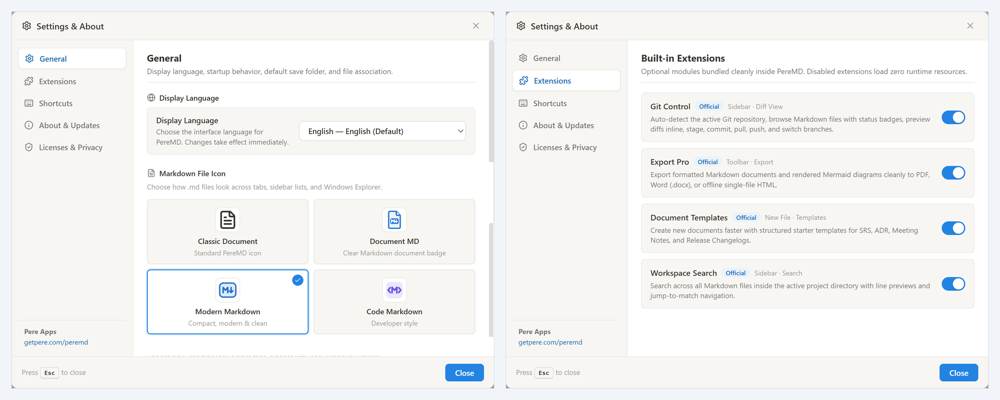

# PereMD — Minimalist Notion-Style Markdown Reader & Visual Mermaid Studio

**PereMD** is a lightweight, fast local Markdown reader and editor for Windows, combining a clean **Termius-inspired** workspace layout with **Notion-style** typography and an offline **Mermaid Visual Studio**.

> [!NOTE]
> PereMD is **closed-source freeware** that runs **100% offline on your device**, with zero analytics or telemetry. Built with Tauri 2 (Rust) and Svelte 5 for Windows x64.



---

## Key Features

### Reading, Editing & Sync Scroll
- **3 Viewing Modes:** Switch seamlessly between `Raw` (CodeMirror 6), `Preview` (Notion-style typography), and `Dual` (50/50 side-by-side split view with a smooth resizable divider).
- **Clean `Read | Edit` Workflow:** Toggle between focused reading and editing with a primary **Save** action for unsaved changes, `/` **Slash Command** insertion menu (`ArrowUp`/`ArrowDown`/`Ctrl+N`/`Ctrl+P`, `Enter`, `Esc`), and click-below-block paragraph creation in Preview mode.
- **Content-Aware Two-Way Sync Scroll:** Synchronizes `Raw` and `Preview` panes by document block structure (`data-block-id`) rather than naive scroll percentage—keeping large tables and diagrams aligned.
- **Display Controls & In-Document Search (`Ctrl+F`):** Customize font size, page width, and dual layout from the **Aa Display Options** popover, and search/highlight matching text across both regular prose and rendered Mermaid diagrams.



### Offline Mermaid Diagrams & Visual Drag-and-Drop Studio
- **30 Mermaid Diagram Types (100% Offline):** Built-in SVG rendering powered by `Pele` with zero internet dependency, syntax highlighting, context-aware autocomplete inside ```` ```mermaid ```` blocks in `Raw` view, live preview, and a searchable **30-template picker**.
- **Visual Drag-and-Drop Canvas:** Visually edit **Flowchart, Swimlanes, ER, State, Mindmap, Sequence, Class, C4, and Architecture** diagrams directly on the canvas while preserving comments and frontmatter:
  - Unified compact toolbar, quick-insert canvas rail, dot-grid background, live zoom (`Ctrl + Mouse Wheel`), synced fullscreen overlay, and an interactive `?` user guide.
  - Categorized **30-shape Flowchart picker** (`Basic` / `Process` / `Technical`), two-row SVG connection palette, **18-swatch Fill & Border color pickers**, edge curve routing, arrowhead/line thickness controls, node duplication (`Ctrl+D`), edge selection glow, Undo/Redo history, and inline multiline double-click text editing.
  - Keyboard shortcuts: `Del`, `F2` / `Enter`, `Ctrl+D`, `Space+Drag`, and layered `Esc`.
- **Simple & Colorful Diagram Palettes:** Switch with one click between clean monochrome **Simple** styling and curated **Colorful** palettes across all 30 Mermaid diagram types, with newly added nodes automatically inheriting the active palette.
- **Diagram Export:** Export any Mermaid diagram directly to **SVG** or high-resolution **PNG (2x)**, or copy its source.





### Workspace, Multi-Tab & File Management
- **Multi-Tab Workflow & Unsaved Protection:** Open multiple documents in tabs with right-click actions (**Close Tab**, **Close Other Tabs**, **Close Tabs to the Right**, **Close All Tabs**), a batch unsaved-changes confirmation dialog (`Save All & Close`, `Close Without Saving`), and prompts when open files change on disk.
- **Session & Layout Memory:** Optionally reopen tabs from your previous session on launch and preserve Outline (Table of Contents) visibility, maximized window state, and `F11` fullscreen state across restarts.
- **Library Sidebar & Favorites:** Organize files into hierarchical Favorites folders with drag-and-drop, browse Recent Files with search and pagination, create new `.md` files quickly, and manage files via right-click (`Copy Filename`, `Copy Path`, `Open File Location`, `Rename`, `Hide`, `Delete`).
- **Custom Titlebar & Document Status Footer:** Compact custom Windows titlebar paired with a status footer displaying the active save folder (click to reveal in Explorer), detected Git branch badge, total lines, and character count.
- **Customizable `.md` File Icons:** Choose from 4 Markdown icon styles (**Classic Document**, **Document MD**, **Modern Markdown**, **Code Markdown**) in Settings for both PereMD tabs/lists and Windows Explorer file associations.

### Built-in Opt-In Extensions Suite
Enable any of the four built-in productivity extensions from `Settings → Extensions` *(all off by default)*:
- **Git Control:** Inspect changes, view inline diffs, stage/discard edits, switch branches, and commit, pull, or push directly from the sidebar.
- **Workspace Search:** Search Markdown files across your active folder or repository with instant context snippets, visible Mermaid label matching, and click-to-jump navigation.
- **Document Templates:** Create documents faster using built-in **SRS**, **ADR**, **Meeting Notes**, **Release Changelog**, and **Project README** blueprints, or save your own custom templates.
- **Export Pro:** Export formatted documents and Mermaid diagrams to **PDF**, **Word (`.docx`)**, or **offline HTML** using **Corporate**, **Technical**, or **Minimal** presets with optional cover pages, TOC, headers/page numbers, and automatic landscape framing for wide tables.





### 30-Language Global Localization
- **Full UI Localization:** Available in **English** (default) plus **29 additional languages** (`Tiếng Việt`, `日本語`, `한국어`, `简体中文`, `繁體中文`, `Français`, `Deutsch`, `Español`, `Português (Brasil)`, `Português`, `Italiano`, `Nederlands`, `Русский`, `Українська`, `Polski`, `Türkçe`, `Bahasa Indonesia`, `Bahasa Melayu`, `ไทย`, `हिन्दी`, `Čeština`, `Slovenčina`, `Svenska`, `Dansk`, `Norsk`, `Suomi`, `Magyar`, `Ελληνικά`, `Română`) across menus, tooltips, dialogs, Mermaid canvas overlays, and built-in extensions—with adaptive layout sizing and instant switching in Settings.
- **Windows Installer Language Sync:** Pick your preferred language in the Windows installer and PereMD automatically launches in that language on first run while preserving existing preferences across silent updates.



### Privacy, Security & Updates
- **Local-Only Storage:** Workspace metadata and Favorites are stored locally in SQLite (`%APPDATA%\com.peremd.reader\peremd.db`).
- **Sanitized Rendering & Remote Image Protection:** HTML output is sanitized with `ammonia` (blocking `<script>`, `<iframe>`, `javascript:`, and inline event handlers), and external remote images are blocked by default until you explicitly allow them.
- **Licenses & Privacy Viewer:** Inspect local-only privacy guarantees and third-party notices (`THIRD-PARTY-LICENSES.txt`) in Settings.
- **Privacy-First Auto-Updater:** Check for, download, and install signed updates from GitHub Releases inside `Settings → General & About`. Automatic startup update checks are **off by default** (and updater controls are automatically disabled in Microsoft Store builds).

---

## Download & Installation (Windows x64)

Download the latest release (**v0.5.0**) from **[GitHub Releases](https://github.com/pereapps/PereMD/releases/latest)**:

- **`PereMD_<version>_x64-setup.exe`**: Standard NSIS installer (registers `.md` / `.markdown` file associations, supports installer language sync, and enables signed auto-updates).
- **`PereMD_<version>_x64_Portable.zip`**: Portable archive — extract and run without installation.

*(Please verify the `SHA-256` checksum included in each Release's notes to ensure file integrity. See [CHANGELOG.md](CHANGELOG.md) and [GitHub Releases](https://github.com/pereapps/PereMD/releases) for version history.)*

---

## FAQ & Bug Reports

- **Why does Windows SmartScreen show a warning on first launch?**
  Early freeware builds are not yet signed with a commercial Authenticode EV certificate. You can verify the `SHA-256` checksum against the Release page and click *More info → Run anyway*, or use the `Portable.zip` package.
- **Feedback & Bug Reports:** Please open an issue in **[GitHub Issues](https://github.com/pereapps/PereMD/issues)** with your PereMD version and steps to reproduce.
